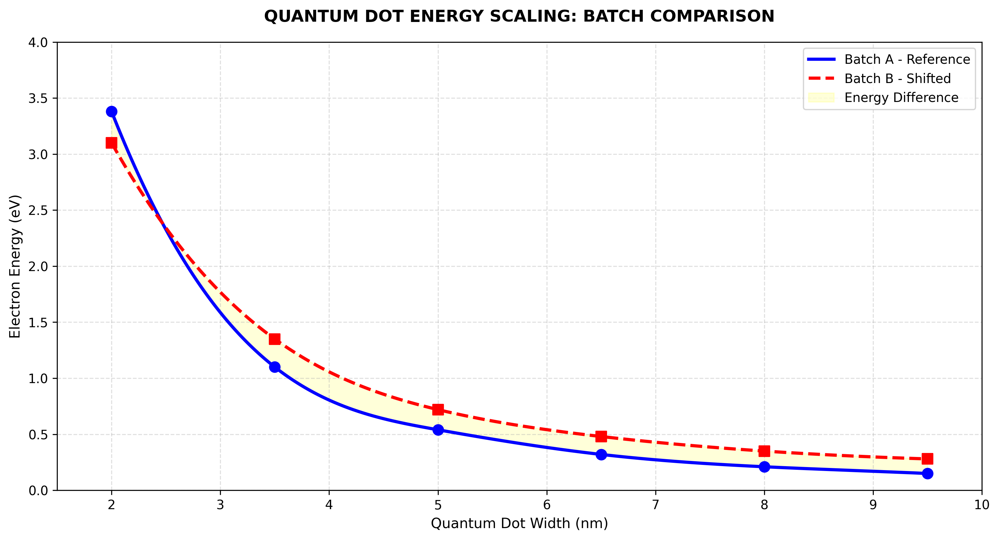

Quantum Dot Semiconductor Simulator Project Overview 

This project explores the relationship between quantum dot dimensions and electron energy through Python-based numerical analysis and scientific visualisation.

Quantum dots are semiconductor nanostructures whose electronic properties are influenced by their size. This project focuses on visualising how electron energy varies with quantum dot width.

Objectives Explore the relationship between quantum dot width and electron energy. Compare two illustrative datasets. Apply numerical interpolation to visualise energy trends. Use computational tools to study a concept in semiconductor physics. Methodology 

The project uses Python and scientific computing libraries:

NumPy: Numerical arrays and data handling. SciPy: Cubic spline interpolation. Matplotlib: Graph plotting and visualisation. 

Two datasets, Batch A and Batch B, are plotted and compared using scatter points and interpolated curves.

Results and Visualisation 

The graph illustrates how electron energy varies with quantum dot width in both datasets.

The scatter points represent the original data, while the smooth curves represent cubic spline interpolation between the supplied values.

Limitations 

The datasets in this project are illustrative and are not verified experimental measurements.

Cubic spline interpolation provides a smooth representation of the supplied data. It does not independently predict the physical behaviour of a semiconductor.

Future Scope Develop a physics-based quantum confinement model. Explore the influence of semiconductor material properties. Compare theoretical calculations with published experimental data. Extend the computational analysis using additional numerical methods. Technologies Used 

Python | NumPy | SciPy | Matplotlib

